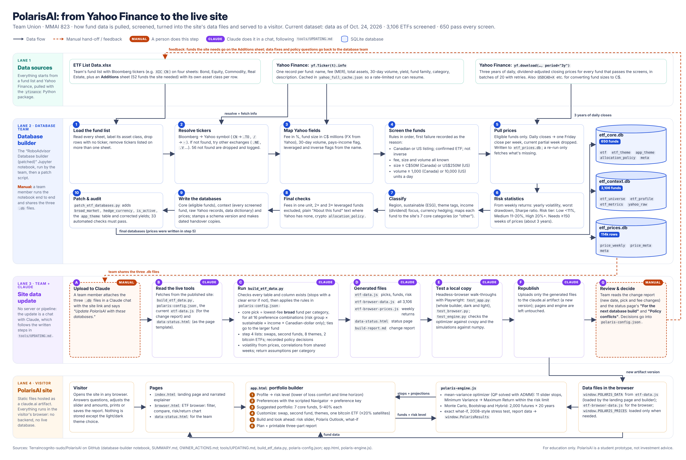

# PolarisAI: a guide to the code

> **For education only.** PolarisAI is a student prototype, not investment advice. Always talk to a licensed financial professional before you buy any ETF.

PolarisAI builds a starter portfolio of Canadian-friendly ETFs from a few questions. It then tunes the mix along a risk slider and projects it 20 years ahead with three simulation methods. This README is for someone who wants to explore how it works. For the routine data refresh, see [`tools/UPDATING.md`](tools/UPDATING.md).

**There is no server, no backend and no live database.** Everything runs in the visitor's browser from static HTML and JavaScript files. The fund data lives in pre-built `.js` files that are regenerated from the team's databases.

---

## 1. How it fits together

[](polaris-architecture.png)

*Click the diagram for the full-size version.* It reads top to bottom in four lanes:

1. **Data sources.** The team's fund list (`ETF List Data.xlsx`) plus fund details and three years of daily prices from Yahoo Finance.
2. **Database builder.** The notebook in [`database-builder/`](database-builder/) loads, screens, classifies and audits the funds, then writes the three SQLite databases.
3. **Site data update.** Claude reads the databases, runs `tools/build_etf_data.py`, tests the result and republishes only the generated files. A team member reviews the change report, and their decisions go back into `polaris-config.json`.
4. **Visitor.** The static pages and `polaris-engine.js` run entirely in the visitor's browser.

The dashed lines are hand-offs between people. Orange **Manual** steps are done by a team member, and purple **Claude** steps are done in a chat, following [`tools/UPDATING.md`](tools/UPDATING.md).

The site side of the diagram, as text:

```
 Team's SQLite databases (built in database-builder/)
   etf_core.db      eligible funds, fees, risk tiers, themes, as-of date
   etf_context.db   every screened fund, profiles, metrics, Yahoo data
   etf_prices.db    weekly prices
          │
          │   tools/build_etf_data.py  +  tools/polaris-config.json (rules, assumptions, placeholders)
          ▼
 Generated files (the site's only "data")
   etf-data.js             → window.POLARIS_DATA     (landing page + builder)
   etf-browser-data.js     → screened funds          (ETF browser)
   etf-browser-prices.js   → window.POLARIS_PRICES   (weekly returns; loaded on demand)
   data-status.html        → status page for the team
          │
          ▼
 Pages                                    Engine
   index.html    landing page               polaris-engine.js  → window.PolarisEngine
   app.html      portfolio builder  ──────▶   optimizer, simulations, what-if,
   browser.html  ETF browser                  stress test, report data
```

Data flows in one direction: databases, then the build script, then the generated files, then the pages. The pages never write anything back.

**What the browser stores:** only the light/dark theme choice (`localStorage` key `polaris-theme`). The builder deliberately starts fresh on every visit. Its `save()` and `psave()` functions are empty on purpose, and on load it clears the old `polaris-profile` and `polaris-prefs` keys left by earlier versions. Two parts of the landing page are only placeholders. The sign-in form saves nothing. The "Speak to a client advisor" button opens a mock "connecting" panel, but no advisor is actually contacted.

---

## 2. Tour of the files

### Pages

| File | What it is |
|---|---|
| `index.html` | Landing page: hero, the narrated explainer video (scenes in `SCENES`, audio `voiceover-v9.mp3`), "How it works", About and the placeholder sign-in. Loads `etf-data.js` for its fund counts and facts. |
| `app.html` | The portfolio builder, with all the UI logic in one inline script. Sections: `#profile`, `#result`, `#prefs`, `#port`, `#cust`, `#opt`, `#plan` (see section 3). Loads `etf-data.js` and `polaris-engine.js`. |
| `browser.html` | ETF browser: filter, sort and search every screened fund, open a detail drawer, compare up to a few funds (growth chart and correlations), and a risk/return scatter tab. Loads `etf-browser-data.js`, then pulls in `etf-browser-prices.js` when you compare. |
| `data-status.html` | Generated by the build script: data as-of date, current picks, and requests for the next database build. |

### Data and engine

| File | What it is |
|---|---|
| `etf-data.js` | Sets `window.POLARIS_DATA`: `cats` (the 7 core categories), `funds` (keyed by id such as `"XIC CN"`, placeholders as `"PH:XYZ"`), `picks` (core picks per preference key), `second`, `swaps`, `themes`, `extras`, assumptions, volatility and correlations. **Generated, don't hand-edit.** |
| `etf-browser-data.js` | Every screened fund (eligible and excluded, with the reason). **Generated.** |
| `etf-browser-prices.js` | Sets `window.POLARIS_PRICES`: `weeks` (dates) and `r` (weekly returns in basis points per fund). **Generated.** |
| `polaris-engine.js` | The quant core. No dependencies, and it runs in the browser and in Node. Settings are in `CFG` at the top. |

### Audio

| File | Used by |
|---|---|
| `voiceover-v9.mp3` | Landing-page explainer video. |
| `cs-voice.mp3` | The 42-second core-and-satellite explainer in step 3 of the builder. |

### Team tools (`tools/`, not loaded by any page)

| File | What it is |
|---|---|
| `UPDATING.md` | Data-refresh guide and detailed reference for the engine, report, themes and education notice. |
| `build_etf_data.py` | Reads the three databases and the config, and writes the four generated files plus a change report (`build-report.md`). Stops with a clear error if a table or column is missing. |
| `polaris-config.json` | Category definitions, "broad fund" rules, expected returns, step 4 lists (swaps, second funds, themes, the two bitcoin ETFs), settled `policy_decisions`, and `schema_requests` for the database team. |
| `test_app.py` | Playwright walk-through of the whole builder (dark or light), including report reading-level checks. |
| `test_browser.py` | Playwright smoke test of the ETF browser. |
| `test_engine.py` + `engine_cases.js` | Independent check of the engine. `engine_cases.js` builds portfolios the way `app.html` does and runs the engine in Node. `test_engine.py` compares the results with cvxpy and numpy. |
| `theme_light.py`, `theme/*.css` | Generates the light theme from each page's dark CSS, plus hand-written fixes. |

---

## 3. Follow one client through the code

Take an example client: **$10,000 to start, $500 a month, comfortable with a moderate drop, needs the money in 10+ years.** All functions below are in `app.html` unless marked as engine functions.

**Step 1: Let's get to know you (`#profile`)**
The form asks for the amount, regular contributions, comfort with a drop, and time horizon. On submit, the form handler validates the answers and calls `showResult(s)`.

**Risk level (`#result`)**
`showResult` sets the level to `lower(loss, time)`, the more cautious of the two answers (`RANK = {low:0, mod:1, high:2}`). `LEVEL` holds each level's name, meaning and starting stock/bond split (Low 30/70, Moderate 60/40, High 85/15). Our client is **Moderate**.

**Step 2: Make it your own (`#prefs`)**
The Navigator is a scripted guided conversation (the `pc*` functions, starting at `pcStart()`). It's not an AI call. It asks about region tilt, sustainable (ESG) funds, income focus, bond style and Canadian-dollar-only funds.
`prefKey()` turns the answers into a key such as `lm|0|0|0` (risk group `lm` or `h`, then ESG, income and CAD-only flags). `setPicks()` looks up `POLARIS_DATA.picks[key]`, one fund per core category.

**Step 3: Your suggested starting portfolio (`#port`)**
`buildPortfolio()` and `renderPortfolio()` lay out the 7-fund core with weights from `allocate()`, which shares a total across categories within 5–40% each. This step also has the core-and-satellite video.

**Step 4: Make it your own (`#cust`)**
`renderCust()` offers swaps, a second fund per category, themes (real estate, gold, technology and others) and, at Moderate and High, one bitcoin ETF (FBTC or BTCC.B, 5%). Lists come from `swaps`, `second`, `themes` and `extras` in the data. Tickers not yet in the database show a "Placeholder" tag. `finishCust()` moves on.

**Step 5: Build and look ahead (`#opt`)**
- `engineInput()` packages holdings, tier, amounts and reference weights. `runEngine()` calls the engine function **`PolarisEngine.run(input)`**:
  - `buildModel()` gives expected returns (category assumption minus MER) and a covariance matrix from weekly prices.
  - `buildConstraints()` sets category limits, the tier's stock band, fixed satellite weights and pair minimums.
  - `optimize()` and `buildStops()` find the minimum-variance and maximum-return ends, plus 9 smoothed stops in between, using `QPSolver` (ADMM with active-set polishing).
  - `roundWeights()` rounds to whole percents without breaking limits.
  - `publish()` writes `window.PolarisResults` and fires `polaris:results`.
- `buildSlider()`, `renderSlider()` and `setStop()` drive the 11-stop risk slider.
- `renderOutlook()` calls `PolarisEngine.sims(stop, 'hybrid')` (2,000 paths, 20 years, cached) and draws the fan chart.
- `renderWhatIf()` and `wiUpdate()` call `PolarisEngine.whatIf({...})` when the client changes amounts. It revalues the same paths in about 7 ms.
- `openReport()` and `buildReport()` call `PolarisEngine.report(stop)` and `stressReport()` to build the three-part report. Its charts come from the `rpt*` functions. Download uses the artifact `downloads` capability (`window.claude.use('downloads')`).

**Your PolarisAI plan (`#plan`)**
`renderPlan()` shows the final mix, amounts, next steps and the education notice.

Navigation between steps goes through `goStep(k)`.

---

## 4. Key ideas in plain words

- **Risk limit.** The riskiest stop can't be more volatile than the boldest "reference" mix for the client's tier. That mix sits at the top of the tier's stock band, built from the client's own funds.
- **The 11-stop slider.** Stop 0 is the steadiest mix and stop 10 the highest expected growth within the risk limit. The stops in between hit evenly spaced volatility targets. A small smoothing penalty (`CFG.smooth`) keeps weights from jumping between near-identical funds. It costs under 0.2 points of expected return at worst.
- **Three simulation methods.** *Monte Carlo* uses smooth normal returns. *Bootstrap* replays real weekly returns in random blocks of about 6 weeks. *Hybrid* uses the bootstrap's real ups and downs, re-centred on forward-looking returns, and is the one shown on screen. A fixed seed (`CFG.seed`) means the same inputs always give the same results.
- **What-if.** Each path's monthly growth is stored. New amounts are revalued as `value = value × growth + money added`, so the result matches a full re-run exactly.
- **Stress test.** A crash in the first year by asset class (stocks −40%, bonds −15%, real estate −35%, commodities −50%, crypto −75%), then normal Hybrid behaviour. It appears in the report only.
- **Placeholders.** Funds the database doesn't carry yet use figures from `polaris-config.json`. They switch to database figures automatically once the fund appears.

The full detail is in [`tools/UPDATING.md`](tools/UPDATING.md), under "The optimizer and simulation engine".

---

## 5. Run it locally

You need Python 3, Node (for the engine test) and Playwright (for the page tests).

```bash
# 1. Put the published files in a folder called site/, then serve it
python3 -m http.server 8765 -d site
# open http://localhost:8765/

# 2. Engine: optimizer vs cvxpy, simulators vs numpy, what-if vs full re-run, stress test
pip install numpy scipy cvxpy
python3 site/tools/test_engine.py site

# 3. Builder walk-through (add "light" to test the light theme)
python3 site/tools/test_app.py http://localhost:8765

# 4. ETF browser smoke test
python3 site/tools/test_browser.py
```

You can also use the engine on its own in Node:

```js
global.window = globalThis;
eval(require('fs').readFileSync('site/etf-data.js', 'utf8'));
eval(require('fs').readFileSync('site/etf-browser-prices.js', 'utf8'));
const E = require('./site/polaris-engine.js');
// build an input like tools/engine_cases.js selection(), then:
// const r = E.run(input); E.sims(r.start, 'hybrid'); E.whatIf({...}); E.stress(5);
```

`tools/engine_cases.js` is the best worked example of building a valid input.

---

## 6. Where to change things

| I want to… | Edit | Then |
|---|---|---|
| Change how core funds are picked, or the "broad fund" rules | `tools/polaris-config.json` | Rerun `build_etf_data.py` |
| Change expected returns per category | `assumptions.ret` in `polaris-config.json` | Rerun the build |
| Add or change a step 4 swap, second fund, theme or extra | `swaps`, `second`, `themes`, `extras` in `polaris-config.json` | Rerun the build |
| Change paths, seed, category limits, stock bands, slider stops or smoothing | `CFG` at the top of `polaris-engine.js` | Run `test_engine.py` |
| Change stress-test shocks | `CFG.stress` in `polaris-engine.js` | Run `test_engine.py` |
| Update the risk-free rate (Sharpe ratio) | `CFG.riskFree` in `polaris-engine.js` | |
| Change the questions or risk levels | `#profile` markup, `LEVEL` and `lower()` in `app.html` | Run `test_app.py` |
| Change the Navigator's wording | The `pc*` functions in `app.html` | Run `test_app.py` |
| Change the report | `buildReport()` and the `rpt*` chart functions in `app.html` | `test_app.py` checks a reading level of grade 9 or lower for Parts 1–2 |
| Add an investor quote | `QUOTES` in `app.html` (only with a verified source) | |
| Change any page's colours or CSS | The page's `<style>` | Rerun `tools/theme_light.py site` |
| Refresh the fund data | Follow `tools/UPDATING.md` | Republish only the four generated files |

**House rules:** keep the education notice on every page (`.edu-note`). Write user-facing text at about a grade 8 reading level. Don't hand-edit generated files or the `light-auto` style block.

---

## 7. Glossary

| Term | Meaning |
|---|---|
| **ETF** | Exchange-traded fund: a basket of stocks or bonds you buy like one stock. |
| **MER** | Management expense ratio: the fund's yearly fee, as a percent of what you hold. |
| **Core / satellite** | Core: the 7 broad, low-cost funds. Satellites: optional smaller add-ons (themes, extras). |
| **Volatility** | How much returns swing around their average, per year (standard deviation). |
| **Correlation** | How closely two funds move together, from −1 to +1. |
| **Covariance matrix** | Volatilities and correlations combined. The optimizer's model of risk. |
| **Minimum variance** | The mix with the smallest swings. |
| **Efficient frontier** | The best expected return available at each level of risk. |
| **Sharpe ratio** | Return above the risk-free rate, per unit of volatility. |
| **Beta** | How much a mix moves when the market moves (here against XIC and ACWI). |
| **Drawdown** | The fall from a peak to a low. |
| **VaR / CVaR (95%)** | Value at Risk: the 1-in-20 bad-year loss. Conditional VaR: the average loss in those worst years. |
| **Bootstrap (stationary block)** | Resampling real past returns in random-length blocks to keep streaks and fat tails. |
| **QP / ADMM** | Quadratic programming, the type of optimization problem. ADMM is the algorithm the solver uses. |
| **Placeholder** | A fund not yet in the database, using figures from the config. |
